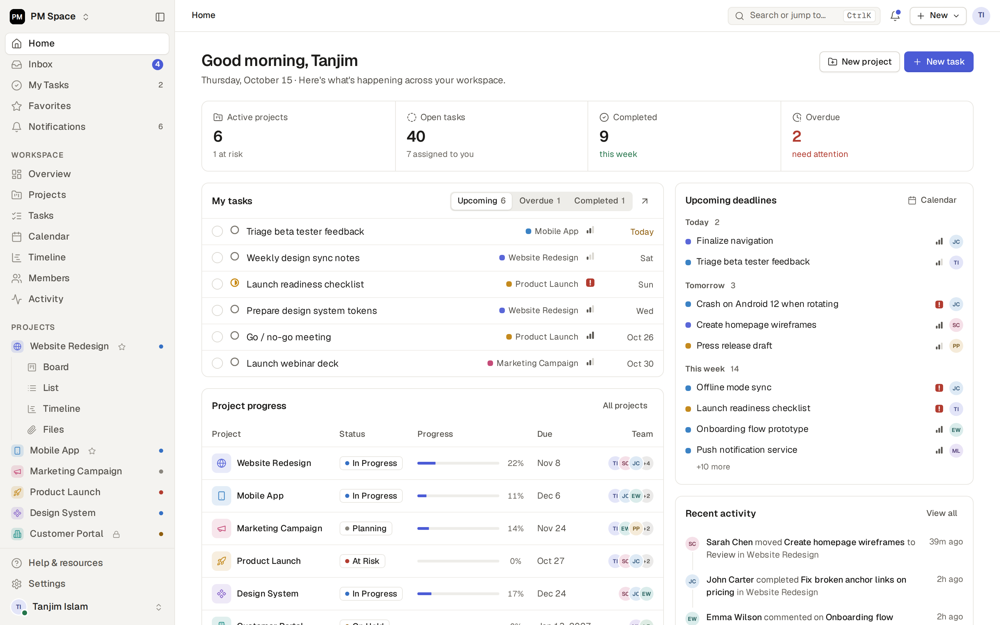

# PM Space

A calm, structured project management workspace: home dashboard, inbox, my tasks, projects with
board / list / table / calendar / timeline / files views, members, teams, activity and settings.

Built with plain JavaScript ES modules and CSS, bundled by [Vite](https://vite.dev). There is no
UI framework. The one runtime dependency is the [PocketBase](https://pocketbase.io) JS SDK: the app
keeps its data on a PocketBase server, which also serves the built app.



## Getting started

Requires Node.js 18 or newer (`.nvmrc` pins 22). The app needs a PocketBase server, so development
runs two processes.

```bash
npm install
scripts/get-pocketbase.sh   # once: downloads the pinned PocketBase into server/ (Windows: scripts\get-pocketbase.ps1)
npm run server              # terminal 1: PocketBase on http://127.0.0.1:8090
npm run seed:dev -- --dev-database   # once: demo users and data; prints the sign-in details
npm run dev                 # terminal 2: http://localhost:5173 with hot reload, /api proxied to PocketBase
```

Sign in with one of the accounts that `seed:dev` prints. It only runs against a local, empty dev
server, needs the `--dev-database` flag as your word that the database is a throwaway one, and refuses anything else;
never run it on production.

```bash
npm run build         # production build in dist/
npm run build:server  # production build into server/pb_public, served by PocketBase
npm run preview       # serve the production build locally
npm run lint          # ESLint
npm run format        # Prettier
```

## Project structure

```
index.html              HTML entry; loads src/main.js
public/favicon.svg      brand mark
vite.config.js          Vite config, including the Lucide icon-subset plugin
eslint.config.js        lint rules (ESLint flat config); formatting by Prettier (.prettierrc.json)
.github/workflows/      CI: lint, format check, build
docs/preview.png        README screenshot
docs/deploy.md          install, HTTPS, users, backups and upgrades for the company server
docs/phase-1-backend.md the plan for the PocketBase backend
scripts/                get-pocketbase.sh / .ps1 (pinned PocketBase download) and the helpers behind npm run server and seed:dev
server/                 the PocketBase side
  pb_migrations/        JS migrations: every collection and API rule, applied when the server starts
  pb_hooks/             server hooks (401 when not signed in, new-account defaults, no stale app page, field-by-field saves, download names)
  pb_public/            the built app (git-ignored; npm run build:server writes it)
  pb_data/              database and uploaded files (git-ignored; this is what gets backed up)
src/
  main.js               entry: imports styles and modules, then boots the app
  styles/
    index.css           imports every stylesheet in cascade order
    tokens.css          colours, spacing, type, radius, the shared --gutter
    base.css  components.css  shell.css  panels.css  overlays.css  states.css  motion.css  responsive.css
    views/              list, board, table, calendar, timeline, projects & files
    pages/              settings & sign-in
  core/                 utilities, constants, icons, store (state + lookups), theme
    pb.js               PocketBase client (server URL, sign-in state)
    sync.js             sync engine: loads data, saves changes, applies live updates
    sync-map.js         maps app objects to PocketBase records and back
  data/seed.js          demo workspace data
  ui/                   shared render helpers, toasts, the select dropdown
  shell/                render loop and router, sidebar/topbar layout, skeletons, view engine
  components/           task list renderer
  pages/                one module per route
  views/                project views: board, table, calendar, timeline, files, overview
  overlays/             task drawer, modals, popovers, context menu, command palette
  features/             teams, subtasks, archive (rendering)
  actions/              user actions, event wiring, keyboard shortcuts, drag and drop
```

### Layers

Dependencies point downward:

1. `core/` and `data/` depend on nothing else in the app.
2. `ui/`, `shell/`, `components/`, `pages/`, `views/`, `overlays/` and `features/` render HTML from state.
3. `actions/` change state and re-render. Each action module registers its handlers on the
   shared action table (`A`) when it loads, so `main.js` imports them after `actions/actions.js`.

## Conventions

- **Rendering:** each page or view is a function that returns an HTML string from the store
  (`S`). `render()` rebuilds the shell and keeps focus and scroll positions.
- **Interactions:** elements declare `data-a="actionName"`. `actions/events.js` delegates the
  click to `A.actionName`. Inputs use `data-in`, blur handlers use `data-blur`.
- **File inputs:** never put an `<input type="file">` in a template. A render while the system
  file dialog is open (a colleague's change arriving) would throw the input away together with the
  person's choice. Use a control with `data-a="pickFiles"` (`data-project`, optional `data-task`):
  it opens the one hidden input that `actions/actions.js` keeps outside the rendered page.
- **Layout:** every page edge uses `var(--gutter)`, so the breadcrumb, page header, toolbar,
  list, table and board start on the same line.
- **Dropdowns:** write a normal `<select class="select">`. `ui/select.js` renders it as the
  design-system menu and keeps the native element as the source of truth.
- **Icons:** call `ic('name')` with any [Lucide](https://lucide.dev) icon name. The
  `virtual:icons` plugin bundles only the icons the source uses.
- **Stored data is untrusted:** every signed-in user can write records that everyone else
  renders. Put text and attribute values through `esc()`, colours through `safeColor()`, task
  descriptions through `sanitizeHtml()`, and read status, priority and similar keys from the
  tables in `core/constants.js`, which fall back instead of throwing (`core/safe.js`). Uploaded
  files are the same: only png, jpg, gif and webp are ever drawn, and only through ``
  (`isRaster()` in `core/files.js`). Everything else is downloaded (`download: true`), never put in
  an iframe or object, and never opened in the app's own window.

## Continuous integration

Every push and pull request runs lint, the format check and a production build
(`.github/workflows/ci.yml`).

## Deploy

The app runs on one company server, served by PocketBase. `docs/deploy.md` covers installing it as
a service, HTTPS, creating the first admin and users, nightly backups, restoring and upgrading.

`vercel.json` still builds the front end alone and serves `dist/`. A static host has no PocketBase
behind it, so the app cannot load or save data there.
